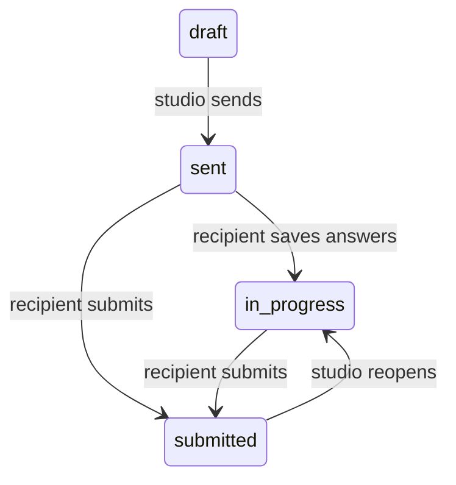

# Functional and architecture guide

Reviewed: 12 November 2026. This is a map of current implementation, not a
roadmap or evidence of production deployment. See [UI](UI.md) and [UX](UX.md)
for interface and journey contracts. Paths to the backend and landing frontend
assume the sibling checkout layout used in this workspace.

## System boundary and sources of truth

| Directory | Responsibility | Main sources |
| --- | --- | --- |
| `markyos-frontend` | Next.js/React platform, local cache/demo, authoring, public viewers, operator UI | [routes](../../src/app), [AppContext](../../src/contexts/AppContext.tsx), [repository](../../src/lib/data/repository.ts) |
| `markyos-backend` | Django/DRF API, authentication, authorization, documents, relational workflows and provider calls | [URL configuration](../../../markyos-backend/config/urls.py), [apps](../../../markyos-backend/apps) |
| `landing-frontend` | Separate bilingual website and Payload CMS; separate deployment and CMS accounts | [README](../../../landing-frontend/README.md), [Payload config](../../../landing-frontend/payload.config.ts) |
| `markyos-brand` | Designer-supplied SVG originals | Sibling asset folder; not a standalone Git repository in this workspace |

The checkout root is not a Git repository. Platform, backend and landing are
separate repositories. Keep their changes, migrations and deployment settings
coordinated; a frontend commit alone does not deploy a backend contract.

There are two platform execution modes:

| Mode | Trigger | Behavior |
| --- | --- | --- |
| Browser-only | `NEXT_PUBLIC_API_URL` unset/empty | Seed/demo accounts, local brand documents, local auth behavior and browser-only public links. Data is not portable to another browser. |
| API-backed | Nonempty `NEXT_PUBLIC_API_URL` | Django accounts and shared documents; browser cache remains; dedicated API workflows handle discovery, calls, analysis, approvals, sign-offs and billing. |

The variable should point at the API base, for example
`http://localhost:8000/api/v1`. It is a public build-time frontend setting;
provider credentials belong on the backend. Read [client.ts](../../src/lib/api/client.ts)
and [apiAdapter.ts](../../src/lib/data/adapters/apiAdapter.ts), not old comments
that say brands are not yet stored on the server.

Prisma schema/config/scripts remain in the frontend as a foundation/scaffold.
No runtime Prisma client usage was found in `src` during this review. Current
API-backed persistence is Django; do not add a second live write path because a
Prisma model happens to exist. Its config still requires `DATABASE_URL` and
`SHADOW_DATABASE_URL` for the frontend's Prisma validation step.

## Roles, permissions, and account limits

There are three independent axes:

1. Platform account role: `admin` or `member`. Superusers also satisfy platform
   admin permission. Operator APIs use `IsPlatformAdmin`.
2. Account type: `studio`, `freelancer`, `company`, or untyped. This controls
   owned-brand/editor limits, wording and prices; it is not a brand role.
3. Brand role: owner or email-matched editor/viewer/client membership. Owner is
   the workspace's owner relation, not a client-supplied role string.

| Brand action | Owner | Editor | Viewer | Client |
| --- | --- | --- | --- | --- |
| Read general brand document | Yes | Yes | Yes | Yes |
| Save content document | Yes | Yes | No | No |
| Manage team / transfer ownership | Yes | No | No | No |
| Read internal discovery, call notes, analysis | Yes | Yes | Yes | No |
| Write internal discovery, call notes, analysis | Yes | Yes | No | No |
| Read approval queue / sign-off notes | Yes | Yes | Yes | Yes |
| Submit approval proposal | Yes | Yes | No | No |
| Decide approval / resolve sign-off | Yes | No | No | No |
| Brand deletion / checkout | Yes | No | No | No |

Public recipients use separate scoped endpoints, not a membership role.
Platform admin does not automatically grant ownership/edit access to every
brand through the normal brand API. Visibility generally returns 404 for a
brand outside the account's membership rather than confirming it exists.

Frontend guards and `roleOn`/`canEdit` guide the interface. Django permission
checks remain authoritative. Dedicated internal discovery endpoints exclude
client memberships; the general authenticated brand-document response is not
an equivalent per-field privacy filter. Do not place confidential internal
notes in arbitrary workspace JSON and assume the client role cannot read them.

[Backend limits](../../../markyos-backend/apps/accounts/limits.py) are mirrored
in [frontend account types](../../src/constants/accountTypes.ts):

| Type | Owned brands | Editor seats |
| --- | --- | --- |
| Studio | Unlimited | Unlimited |
| Freelancer | 3 | 0 |
| Company | 1 | Unlimited |
| Admin or untyped | Unlimited | Unlimited |

Limits gate additions; an administrative downgrade does not delete existing
brands/editors. Viewer/client seats do not count as editor seats. Ownership
transfer checks the recipient's brand limit. Keep the frontend explanation and
server enforcement aligned when changing these values.

## Modules and persistence

| Module | What it does now | Storage / implementation boundary |
| --- | --- | --- |
| Auth/account | Signup/setup, password/Google sign-in, email codes, resets, profile/email change, sessions and account controls | Django account/auth models; local demo alternatives in frontend |
| Brands/overview | Brand creation, summary, team ownership, shared document editing | `Workspace.data` JSON plus owner, slug, version and membership/public-link indexes |
| Strategy | Narrative fields, values, audience/personas, competitors, positioning and voice in English/Arabic | Brand document; translation goes directly to MyMemory from browser |
| Visual identity/type lab | Logo slots, color palettes, typography, assets and specimen work | Brand document plus file storage; frontend analysis/preview tools |
| Moodboard | Boards, images, canvas organization, comments/votes represented by app state | Brand document and uploaded assets; not a real-time collaboration transport |
| Builder/guidelines | Templates, pages, authored/derived sections, styles, preview, publish/unpublish | Live document and published snapshot; public viewer reads snapshot |
| Departments | Instructions, imported handbook sections, curated strategy references | Brand document; public department projection limits references |
| Discovery forms | Library/templates, bilingual typed questions, visibility conditions, sending, answering, reopening, events | Relational discovery models and dedicated API |
| Call notes | Notes/transcripts, participant/speaker structure, analysis inclusion, deletion/restore | Relational call-note records/events and dedicated API |
| Brief analysis | Source-backed analysis versions, 10 sections, citations, edits, regeneration, comparison and sharing | Relational analysis/section/share/event records; LLM worker in web process |
| Drafts | Proposed strategy/identity content for human acceptance or rejection | Brand document; acceptance can apply selected content |
| Compliance | Brand/content checks including local copy lint | Frontend checks and document results; not an external legal certification service |
| Team/reviews | Membership plus approval proposals and client sign-off handling | Membership index; approvals/sign-offs are separate server records |
| Brand settings | Public access settings, per-brand billing and developer/domain controls | Mixed: real Stripe API plus document-only integration settings |
| Board/people | Cross-brand views derived from the account's visible workspaces | Frontend projections; do not infer separate project-management or contact APIs |
| Operator admin | User directory/detail, status/type changes, invitations, sessions, activity, bulk actions and brand lookup | Dedicated `/admin/` APIs and admin-action records |

## Authentication and session behavior

The platform's account API is under `/api/v1/auth/`; it is independent of
Django's `/admin/` and the landing site's Payload login.

- API signup sends name/email/account type and returns password-setup state.
  A valid emailed setup/reset link sets the password, verifies the inbox, and
  issues a session. Existing registration-code flows also remain implemented.
- Login can require an email code when verification/two-factor state requires
  it. Code verification and resend carry a purpose (`register` or `login`).
- Google uses backend verification of the authorization-code identity. A new
  account may need account-type selection before completion.
- Access JWTs live in frontend module memory and travel in `Authorization`.
  Refresh JWTs live in an HTTP-only cookie under `/api/v1/auth/`, default
  `SameSite=Lax`; production sets `Secure`. Rotation blacklists old refresh
  tokens and updates the recorded login session.
- Reload restores the access token through refresh. Concurrent refreshes share
  an in-tab promise and, where supported, a browser Web Lock across tabs.
- Reset/password change revoke existing refresh sessions and issue this browser
  a fresh one. Do not describe this as immediate revocation of every already
  issued access JWT: default access-token validation and refresh revocation
  have different lifetimes.
- Pending email change does not replace the address until confirmed. Membership
  email indexes/documents are updated when confirmation changes the address.

Sources: [session helpers](../../../markyos-backend/apps/authentication/session.py),
[auth views](../../../markyos-backend/apps/authentication/views.py),
[auth service](../../src/components/features/auth/services/authService.ts).

## API areas and error handling

All platform REST families below are relative to `/api/v1/`; the website's
Payload routes are a different API.

| Family | Main responsibility |
| --- | --- |
| `auth/` | Signup/login, account, verification and session lifecycle |
| `brands/` | Document list/create/detail, file upload, approvals and sign-offs |
| `discovery/` | Library/templates, forms, questions and studio-side responses |
| `call-notes/` | Studio note/transcript records and related actions |
| `briefs/` | Analysis runs, sections, comparison and sharing |
| `billing/` | Checkout/confirmation/portal and signed Stripe webhook |
| `admin/` | Platform operator accounts, sessions, activity and bulk actions |
| `public/` | Token/slug-scoped recipient surfaces |
| `health/`, `cron/` | Service health and configured maintenance hooks |

The frontend `api()` wrapper parses DRF errors and field errors, keeps request
IDs and numeric `retryAfterSeconds` when returned, retains response data, and performs one
refresh/retry for a 401 on an authenticated request. Status handling is endpoint
specific: 400 is validation, 401 authentication, 403 forbidden/gated content,
404 missing/invisible, 409 conflict/already submitted, 410 revoked/closed on
applicable form endpoints, 429 throttled, and 503 unavailable integration.
Client `ApiError.status === 0` represents a network failure, not an HTTP status.
Do not flatten all of these into an empty successful result.

Password login carries a typed `loginFailure` alongside its outcome. Only a 401
from the credential request maps to invalid credentials; a later profile-read
401 does not blame the password. Render the failure with `AUTH_COPY`, rather than
matching or translating backend prose. The password form uses localized generic
copy for unrecognized failures. Other features must make their own endpoint-aware
mapping; this is not a global translation of every `ApiError.message`.


## Brand document saves and concurrency

1. Frontend state changes are saved through the local adapter. Large file bytes
   use IndexedDB/blob references rather than inflating the local JSON snapshot.
2. In API mode, changed owner/editor documents are sent after 1 second of quiet;
   hiding the tab requests an immediate sync. Uploads happen separately and the
   saved document carries server URLs.
3. Create preserves a valid client ID; a conflicting slug can be suffixed by the
   backend. Update includes the version last read and must match the URL ID.
4. The server supplies billing, approval history and sign-off records. Editors
   cannot replace the team. An owner's team change can transfer ownership.
5. Update locks the workspace and atomically writes the document, version,
   public-link index and memberships. An index failure rolls the save back.
   Invitation work is called after the save's transaction block.
6. A stale version returns 409 and `current`. The adapter **adopts the server
   document**, discarding conflicting local changes; there is no field merge.
7. Network/5xx/429 failures schedule a 5-second retry. Refused writes can reload
   the stored copy; loss of membership can remove the cached brand.

Local persistence is useful for interrupted connectivity, but this is not a
complete durable sync queue, multi-user CRDT, or real-time collaboration layer.
A local success/toast is not a server acknowledgment. Preserve retry and conflict
semantics when extracting logic from the large `AppContext`.

The frontend `lib/doc/core` expresses typed operations, primary-view structure,
localization and responsive overrides. Its comments describe a future shared
server contract, but the current Django brand serializer accepts JSON with an
ID and does not execute that TypeScript operation validator. Do not claim a
fully integrated operation-based backend or universal enforcement of secondary
view rules; current whole-document role/version checks are the actual boundary.

## Discovery and analysis workflows

[Form status](../../../markyos-backend/apps/discovery/status.py) enforces:



Resending an already sent/in-progress form does not reset it. After sending,
wording/help, theme/settings and new optional questions are allowed; structural
changes that invalidate existing answers are refused. Submitted forms require
reopening before question edits, with theme/settings exceptions in the status
policy. Library questions are copied into forms, so later library edits do not
rewrite a sent questionnaire.

Public answering requires the form's random token; retrieving saved answers
also uses a resume token. Question types are text, choice, scale, ranking, image choice, upload and link.
The server validates their configurations/answers, required fields and
conditional visibility rules. Hidden/unknown question answers are refused.
Draft, revoked, submitted and closing-date conditions are checked separately.
Discovery uploads use their own question configuration and endpoint, with a
50MB ceiling; do not apply the 25MB brand-upload limit by assumption.

Call notes and submitted/selected form sources feed analysis. Current brief
analysis sections are snapshot, goals, audience, market, personality, tensions,
gaps, routes, creative and constraints. Analysis records preserve source
context and allow citations, section edits/regeneration, version comparison,
sharing and proposed drafts rather than silently overwriting strategy.

The [runner](../../../markyos-backend/apps/briefs/jobs.py) uses a daemon thread
inside the web process, not Celery or a durable queue. Restarting the process
can interrupt work. Runs older than 30 minutes can be marked failed during the
stuck-run checks. Test settings can run inline; dev E2E uses fake analysis.

[Credit rules](../../../markyos-backend/apps/briefs/credits.py) quote a free first
successful run per brand, then 10 credits per full run and 2 per successful
section regeneration, with settlement/refund logic. However `balance`,
`charge`, and `refund` are stubs. No real credit ledger, balance enforcement or
money deduction exists. Do not expose quotes as proof of actual accounting.

## Publication, sharing, and review records

Publishing copies the live brand into `published`; the public guideline reads
that snapshot. A later draft edit does not update the public copy until another
publish. API public site access also checks current verified billing, so an old
snapshot cannot retain a revoked paid entitlement.

Public endpoint families under `/api/v1/`:

| Family | Contract |
| --- | --- |
| `public/sites/` | Published guideline, password unlock and client sign-off |
| `public/share/` | Live strategy or selected department by share token |
| `public/forms/` | Recipient questionnaire, answers, uploads and submission |
| `public/briefs/` | Explicitly shared analysis report |

General public brand payloads use an explicit presentation-field allowlist and
empty private collections. Team emails, owner account ID, other share tokens,
drafts, unknown future fields, gate password and developer credentials must not
leak. Department links additionally project only the selected department,
referenced purpose/mission/personas/voice traits, and handbook asset. A React
visibility check is insufficient if forbidden fields are already in the JSON.

Password unlocking yields a signed token valid for 12 hours or until the
password changes; the frontend keeps it in tab storage and sends
`X-Brand-Unlock`. This controls the guideline API, not every direct file URL.
Files are currently public/unguessable URLs, not authorization-checked private
attachments. Revoking a link or setting a page password does not retract files
already downloaded or independently reachable through their URLs.

Sign-offs and approvals are independent relational records. Whole-brand saves
cannot forge/delete their authoritative histories. Anonymous guideline visitors
may submit sign-offs after the access gate; team members read them and only
owners resolve them. Owners/editors propose approval summaries; only owners
approve/reject. Server identities/timestamps and retry references are used;
conflicting repeated decisions return 409. Approval decisions record review
status and do not themselves apply content patches.

Detailed contracts: [sign-offs](../../../markyos-backend/docs/signoffs.md),
[approvals](../../../markyos-backend/docs/approvals.md).

## Billing and provider integrations

Verified backend checkout rows determine paid plans, not saved `billing` JSON
or a checkout success URL. Plans are per brand, not account-wide.

| Account type | One-time pass, USD | Monthly subscription, USD |
| --- | --- | --- |
| Studio | 19 | 29 |
| Freelancer | 15 | 19 |
| Company | 49 | 99 |

Only a verified active subscription or paid pass grants the corresponding
entitlement. Signed Stripe webhooks and authenticated confirmation reconcile
current provider state. An unpaid/pending checkout grants nothing. A fully
refunded pass loses access; a canceled subscription can fall back to a paid
pass. Open subscriptions block destructive deletion. The original buyer's
Stripe customer/payment relationship does not transfer with brand ownership.
See [billing contract and configuration](../../../markyos-backend/docs/billing.md)
for exact event handling and unresolved operational policies.

| Integration | Current implementation / limit |
| --- | --- |
| Stripe | Backend checkout, confirmation, signed webhooks, portal; requires configured secrets and real provider verification before release. |
| Email | Django Anymail/Brevo; setup/reset, invitations, codes and notifications. Runtime delivery depends on credentials/sender configuration. |
| Google | Backend OAuth identity verification with client ID/secret; frontend popup flow. |
| Anthropic | Backend discovery/brief analysis calls; requires API key; test fakes are not live output. |
| MyMemory | Browser calls public translation endpoint, including query text; EN↔AR drafts are flagged for human review and subject to rate limits. |
| Object storage | Local filesystem or configured S3-compatible storage (Spaces/R2/etc.); deployment variables choose the provider. |
| Custom domains | Domain text and status stored; current UI verification uses a timer/local mutation, not DNS or hosting verification. |
| Developer API keys | Browser-generated/document values; no matching server credential issuance/authentication system. |
| Outgoing webhooks | URL setting exists; no delivery/signature/retry event pipeline. |
| Figma | Connection/sync metadata exists; no demonstrated Figma OAuth/data synchronization. |
| Workspace audit history | Browser state exists; not an authoritative backend workspace-action ledger. Admin actions are a separate real server feature. |

## Files and uploads

Brand uploads require authentication and accept supported media/documents up to
25MB. Files get UUID names under a user folder. SVG uploads are rebuilt as
static allowlisted drawing elements/attributes; executable nodes, event
attributes, external references and unsupported stylesheet content are removed.
Malformed/DTD-bearing SVGs are refused. Sanitization can remove unsupported
artwork effects; do not promise arbitrary SVG round-trip fidelity.

Unknown MIME extensions fall back to `.bin`, never an attacker-chosen filename
extension. Locally served media has a sandbox CSP and `nosniff`, protecting
older local uploads too. New cloud uploads use the sanitization path, but old
objects already in a bucket are not rewritten by this change; bucket/CDN
headers and any historical cleanup require deployment-specific verification.
Discovery uploads follow their own validation path and must be reviewed
separately when changing upload policy.

Sources: [brand uploads](../../../markyos-backend/apps/brands/uploads.py),
[brand services](../../../markyos-backend/apps/brands/services.py),
[media serving](../../../markyos-backend/apps/core/views.py).

## Landing website and CMS boundary

Arabic public website routes have no locale prefix; English uses `/en`. Payload
manages blog, guides, help, comparisons, updates and supporting content. CMS
roles and permitted sections jointly control access: admins control publishing
and users, section editors write drafts, viewers read. Anonymous content reads
are restricted to published content; supporting media/taxonomy policies differ.
See [CMS access](../../../landing-frontend/cms/access.ts).

The website's tracking endpoint writes pageviews with coarse device/referrer
information and a daily salted visitor hash; it honors DNT/GPC. Its waitlist
endpoint validates input but returns 501 for ordinary valid signups: persistence
is not wired. Do not claim that applicants are being stored. Marketing `/start`
links can direct people to platform signup; that does not share a CMS session.

## Maintenance, verification, and known inconsistencies

When adding/changing a feature:

1. Choose its authority: brand JSON, dedicated relational records, or a local UI
   preference. Do not store provider-verified or actor-verified data in writable
   browser JSON and then treat it as authoritative.
2. Define read/write permissions in Django and mirror the explanation in the UI.
   Test an owner, editor, viewer, client, stranger and relevant public token.
3. Specify validation, retry identity, stale version handling and transaction
   boundary. Preserve internal/public response projections.
4. Add migrations for relational changes; update frontend DTO conversion and
   local repair defaults without dropping new bilingual fields on reload.
5. Test the failure that matters: duplicate delivery, revoked access, stale save,
   interrupted run, malformed upload or provider refusal—not just happy paths.
6. Update these guides and the feature-specific contract beside the change.

Validation commands:

```sh
# Platform repository; Prisma validation needs both configured database URLs.
npm run check
# Targeted integrated browser tests; see e2e/README.md for isolated server setup.
E2E_PYTHON=/absolute/path/to/markyos-backend/venv/bin/python npm run e2e
# Backend repository, with its development/test environment configured.
venv/bin/pytest
```

The E2E command above is run from the platform directory; use an absolute
Python path because the harness starts the backend with a different working directory. Do not point test runs at production data.
A test suite pass is not proof that live Stripe/mail/Google/storage credentials
or deployment origins are configured.

Known documentation/implementation discrepancies to resolve deliberately:

- Older frontend API comments describe unsynced brands; the API adapter now
  persists them. Prisma and document-operation comments describe target
  architecture that is not the active Django write contract.
- Old UI prose lists outdated motion values; use the current config. Small
  arbitrary text sizes and Latin-only wordmarks still exist despite stronger
  design-intent rules.
- Draft-queue comments imply all imports flow through it. New-brand and strategy
  imports currently review and apply selected content directly instead.
- Some account-language comments say “follow brand”; the interface resolver
  currently uses account preference, then guest/browser choice, then Arabic.
- The old backend translation guide mentions project/beneficiary models outside
  the current main brand API. Strategy translation currently uses MyMemory;
  do not treat that old guide as the strategy contract.
- Custom domains, developer integrations and credits remain partial as listed
  above. The website's token-sync default path is stale and waitlist storage is
  unimplemented. These are not completed features merely because controls exist.
