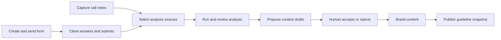

# UX and user journeys

Reviewed: 12 November 2026. This guide describes the implemented platform flows.
Use [UI](UI.md) for visual contracts and [Functional](FUNCTIONAL.md) for API
rules. Route groups such as `(studio)` are source folders, not URL segments.
Keep this document current when changing a route, role experience, or state.

## Evidence and limits

Source review covered route files, guards, feature hooks, persistence adapters,
backend services, and existing tests. An isolated browser inspection of the
local frontend covered login at 1440px and 390px, Arabic dark-mode login,
signup's account-type step, reset request, signed-out gallery redirection, and
a nonexistent share link. These inspected screens had no document-level
horizontal overflow or captured JavaScript page errors. The component gallery
returned 404 with its feature flag off.

Authenticated journeys below are supported by code and existing test coverage;
they were not all replayed interactively during this documentation task. Real
payment, Google sign-in, mail delivery, and production configuration were not
verified. A visible control does not establish that its integration works.

## People and entry points

| Person | Entry and experience |
| --- | --- |
| Studio account | Manages client brands, team members, discovery, and guideline delivery. |
| Freelancer account | Similar authoring experience, with up to three owned brands and no editor seats. |
| Company account | Own-brand wording and department governance; one owned brand by default. |
| Brand owner | Authoring plus membership, ownership, billing, approval decisions, sign-off resolution, and deletion. |
| Brand editor | Edits content and submits proposals; cannot control membership, payment, or owner-only decisions. |
| Viewer | Reads the brand and internal discovery material; cannot edit it. |
| Client team member | Reads general brand content and review queues; internal discovery/call notes/analysis are unavailable. |
| Anonymous recipient | Opens only the token- or slug-based public surface, without a platform account. |
| Platform admin | Starts at `/admin`; manages users and sessions. Admin role does not itself make the person owner of every brand. |

Account type, platform role, and brand membership are separate concepts. Avoid
using “admin” to mean “brand owner.” The landing CMS also has an independent
admin/editor/viewer permission system; its editors are not platform editors.

## Route map

| Route | Purpose / next step |
| --- | --- |
| `/login` | Password or Google sign-in; optional email-code step. |
| `/signup` | Account type, details, email setup or Google onboarding. |
| `/reset` | Request link, then set password when a token is present. |
| `/confirm-email` | Complete a requested account email change. |
| `/brands`, `/brands/new` | Brand gallery and new-brand flow. |
| `/studio/board`, `/people`, `/forms` | Cross-brand board, people, and discovery-form views. |
| `/account` | Personal profile, language, password/security and account controls. |
| `/w/[slug]` | Client-side redirect to `/w/[slug]/overview`. |
| `/w/[slug]/overview` | Brand summary/details and overview content. |
| `/w/[slug]/strategy` | Bilingual strategy editing and sharing. |
| `/w/[slug]/discovery` | Discovery feed and call-note entry. |
| `/w/[slug]/forms` | Forms; `new`, `[formId]/edit`, `send`, and `answers` subflows. |
| `/w/[slug]/analysis` | Brief-analysis versions, source citations, edits and sharing. |
| `/w/[slug]/visual-identity`, `/type-lab`, `/moodboard` | Logo/color/type authoring, specimen work, and boards. |
| `/w/[slug]/builder` | Guideline pages, templates, blocks, styles and publish. |
| `/w/[slug]/departments` | Department instructions and curated brand references. |
| `/w/[slug]/drafts`, `/compliance` | Proposed content review and rule-based checks. |
| `/w/[slug]/team`, `/settings` | Team/reviews and brand access/developer settings, with a link to Account Billing. |
| `/admin`, `/admin/users`, `/admin/users/[id]` | Operator overview, directory and account detail. |
| `/v/[slug]`, `/v/[slug]/p/[page]` | Published guideline and its pages. |
| `/s/[token]` | Live strategy or scoped department share. |
| `/f/[token]` | Recipient's discovery form. |
| `/a/[token]` | Shared analysis report. |
| `/b/[token]`, `/w/[slug]/brief` | Legacy redirects to the form equivalents. |
| `/dev/components`, `/dev/motion`, `/design-system` | UI reference routes gated by `NEXT_PUBLIC_UI_GALLERY=1`. |

The `/w/[slug]/...` shorthand above always refers to a brand route; for example,
`/w/acme/type-lab`, not a top-level `/type-lab` page. Do not infer permission from
this map: guards, feature hooks, and server endpoints all contribute.

## Sign-in, signup, and recovery

### Signup and first use

1. Choose Studio, Freelancer, or Company. A `type` URL parameter may preselect
   the choice, but it remains changeable.
2. Continue to identity/details. API-backed signup sends name, email, and type;
   it does not establish a session or store a password at this step.
3. The UI asks the person to follow a password-setup link from email. Completing
   the valid link sets the password and signs in; first-time onboarding can
   lead to creating a brand. An invitation's safe internal `next` path instead
   returns the person to the invited brand.
4. Google sign-in can return an account-type selection step for a new account.
   An existing account proceeds directly after successful authentication.

Browser-only mode uses local signup/password state and is not an email-delivery
simulation of the backend. Keep those branches explicit in changes and tests.

### Returning sign-in

Login offers email/password, password visibility, “Stay signed in,” recovery,
and Google. A valid login may return a verification/code step instead of a
session. Preserve its email and code purpose through resends and retries.
Successful sign-in uses the permitted internal destination when supplied;
otherwise the account's home is admin overview or the brand gallery.

The password form keeps failures as locale-neutral kinds, then renders them from
`AUTH_COPY` in the current interface language. Wrong credentials, connection
failures, throttling and unavailable services have dedicated copy; unknown server
details use a safe localized fallback. The same invalid-credential message is
used for a missing account and a wrong password. Field errors and an open failure
banner follow language changes without resubmitting credentials. Explicit language
choices update `?lang=` through native history, preserving `next`, hashes and form
state. A numeric `Retry-After` supplies the displayed wait; no delay is invented
when it is missing. This message is not a live countdown.

API sessions restore through the refresh cookie after reload. Do not redirect
to login while hydration/session restoration is still pending. Not every guard
preserves the same destination: `/brands` currently redirects to `/login`
without `next`, while `useStudioPage(next)` supports a return path.

### Password reset and email change

The API reset-request screen advances to a generic check-email state regardless
of account existence. `/reset?token=...` goes to new-password entry. Invalid or
expired links must remain actionable errors, not a successful login. A reset
ends older sessions and issues a new session on success.

In local demo mode, reset can show a local code rather than send email. Never
reuse that behavior in the API path. Email changes remain pending until the new
inbox confirms the link; the old address stays current in the meantime.

## Brand creation and everyday authoring

The gallery shows brands owned by or shared with the signed-in account, supports
search/sorting, and uses account-specific wording and limits. An empty gallery
should offer brand creation where permitted; an empty search result should
clear/change the search rather than claim the account has no brands.

New-brand creation offers scratch (a name) or import from a guideline file.
Import moves through file selection, extraction/progress, review of detected
content, and confirmation. Confirmation creates the brand using the selected
colors/fonts and extracted strategy; a parsing failure returns to file selection
with feedback. Do not describe extraction as a guaranteed complete reconstruction
of the original guideline.

Create a brand, then work within its shell. Brand content is a document:
strategy, visual identity, departments, builder pages and settings update that
document. Feature hooks coordinate actions; route pages generally compose a
feature view. Use existing shell components so the brand context, language,
account menu and navigation stay consistent.

Editing the studio's interface language does not change the brand's primary
content language. Builder preview language/breakpoint is another distinct
choice. A secondary view may expose fewer structural controls; do not create
independent English and Arabic copies of an entire brand to solve layout issues.

## Discovery → analysis → reviewed content

Forms start from templates/library questions and can be themed and bilingual.
Sent forms expose a token link; recipients do not log in. They can save/resume
when enabled, answer visible questions, upload allowed files, and submit. A
submitted form is not editable by the recipient until the studio reopens it.
Draft, revoked, closing-date, submitted and resume-token states are separate.

Call notes can be pasted/imported and edited, with participants/speaker data,
analysis inclusion, delete/restore, and source citations. These are studio
materials, so the client membership role does not see them. The shared brand-navigation
policy hides internal Discovery/Analysis links for clients and shows a bilingual
access notice for direct Discovery, call-note, form, Analysis and legacy Brief
URLs. Clients request a shared form/report link from the owner. A guideline-review
shortcut appears when a published snapshot and a paid brand plan are available;
password protection remains in the public viewer. Keep sidebar filtering and
workspace route handling on the same policy in `src/lib/data/brandNavigation.ts`.

Analysis has source readiness/warnings, queued/running/ready/failed states,
section-level results and retries, version comparison, human edits and public
report sharing. Citations lead back to the relevant answer/call turn. Source
changes can mark a report stale: stale does not mean its historical content has
been rewritten. Missing service configuration must show an unavailable state.

Content drafts and approval requests are **different queues**. Draft acceptance
can apply proposed brand content. Approval requests hold a summary and an
owner's decision; the backend decision endpoint does not apply an arbitrary
content patch. Do not imply that approving a summary automatically publishes
or mutates the guideline. Also, not every import enters the draft queue: the
new-brand import and strategy import have their own review screens and apply
confirmed content directly. Existing draft-queue comments overstate uniformity.

## Publishing and recipient experiences

The builder edits the live studio draft and provides template/page/block tools,
preview, review and publish. Publishing captures a snapshot. Later studio edits
must remain private until republished. A published guideline requires a verified
paid entitlement in API mode; choosing a plan in the browser is not payment.

A recipient visiting `/v/[slug]` can encounter missing, unpublished, password
required, wrong password, unlocked, or service error states. API unlock checks
the password server-side; the browser keeps the returned token for the tab.
An unlocked visitor can send a sign-off note. Keep their note on failure and
reuse its submission reference when retrying a response that may have been lost.
A draft/builder preview is not a sign-off submission surface.

`/s/[token]` reads current shared content, unlike the published snapshot. A
department share contains only that department, its selected purpose/mission,
personas/voice traits, and its attached handbook. Unrelated strategy and files
must not be sent and then merely hidden by React. Revoked, missing and deleted
department states have distinct messages. Browser-only links work only where
the corresponding local data exists; they are not portable public delivery.

`/a/[token]` is a separately shared analysis report. A dead link is not an
invitation to sign in or a fallback to the full brand.

## Team, review, and billing

The owner manages the team and can transfer ownership to an eligible existing
account. Editors can author and propose; viewers/clients read without editing.
Inviting a new email creates an account awaiting password setup. Invitations
are different from silently granting every platform user access.

Owners decide approval requests and handle client sign-off notes. Queue refresh
must load those server records without overwriting unrelated content edits.
Repeated identical decisions are safe; a conflicting second decision gets a
conflict and reloads the current queue.

Payment begins in brand settings and leaves the app for Stripe. Returning from
checkout shows verification/pending/error states until the backend verifies the
actual session. Cancellation is not a success. Subscription management opens
Stripe's portal where permitted. A failed renewal or revoked entitlement should
keep billing recovery reachable without exposing the paid public guideline.

## Saving and feedback

| State | Current mechanism | Guidance when adding features |
| --- | --- | --- |
| Hydrating/restoring session | App state and auth guards wait; some views return `null` | Do not treat unresolved data as “no access.” Blank initial states exist; use a suitable shared skeleton for new substantial waits. |
| Loading a feature | `useRequest` and feature-specific loaders | Preserve existing data during refresh where useful; discard stale responses after the request key changes. |
| Empty | `EmptyState` / `TableEmptyRow` and feature variants | Explain why it is empty and offer an allowed next action. |
| Validation error | Field errors, form error, invalid semantics | Keep values and focus on a useful correction path. |
| Busy | Button/field state and progress | Prevent duplicate actions and show what is in progress. |
| Local save | Local adapter / IndexedDB | A local mutation or toast is not proof of remote persistence. |
| Remote document sync | 1-second debounce; 5-second retry for transient failures | Network/5xx/429 are retried. Do not promise a complete durable offline queue or permanent retry guarantee. |
| Version conflict | Server returns 409 with its current document | Adapter adopts the server copy; local conflicting edits are discarded. There is no merge/conflict editor. |
| Refused save | Adapter may reload the stored copy; `SyncNotices` shows a toast | Explain the refusal; do not leave an apparent successful change that the server rejected. |
| Dedicated API success | Successful request followed by UI feedback | Approval/sign-off/form retries should retain their original reference. |
| Expired session | Refresh failure and session-expired handling | End the local signed-in experience rather than letting every feature fail independently. |

The version-conflict path currently logs a warning and adopts the server copy;
its notice is less explicit than the refused-save toast. Treat that as a known
UX gap, not a human-reviewed merge. Read [apiAdapter](../../src/lib/data/adapters/apiAdapter.ts)
and [SyncNotices](../../src/contexts/SyncNotices.tsx) before changing save feedback.

## Development guidance and unresolved experience

- Confirm the role and API/local mode for every journey before adding controls.
- Define happy path plus loading, no data, no results, invalid input, lost response,
  forbidden access, missing record and expired session states.
- Preserve draft input on failures; ask for destructive confirmation through the
  shared dialog system. Use existing hooks for dismissal, focus and presence.
- Keep feedback truthful: custom-domain “verification,” Figma connection, API-key
  generation and webhook settings are currently local/document behaviors rather
  than completed service integrations.
- Do not advertise charged AI credits: the quote UI exists, but the real ledger
  is not implemented. Background analysis can be interrupted by a web restart.
- Check Arabic reading order separately from interface mirroring; a Latin-only
  wordmark remains in some platform contexts.
- Extend the relevant [E2E scenario](../../e2e/README.md), using API fixtures for
  unrelated setup. Exercise another role/browser for cross-user behavior.
- Update this journey and the [functional guide](FUNCTIONAL.md) whenever an API
  change changes what success, retry or permission means to the person.

### Accessibility updates through audit 1.19

Browser titles identify the current route in the interface language and follow Back navigation. Guideline editor, moodboard, public guideline and embedded preview headings distinguish the page from subordinate content. Section-tab navigation activates locally with arrow keys; adding or deleting a section resolves selection to the new or a surviving section. Scrollable API/comparison examples are named keyboard stops, and inline moodboard links remain underlined before hover. Arabic labels avoid letter spacing, and the builder tool entrance respects reduced motion.

## November audit implementation (2026-11-13)

Brand cards and overview derive five setup steps from saved data: attached logo, colours, both font families, purpose in the brand's primary language and a published snapshot. Supplied default fonts count as configured. Every incomplete step links to its editor. The builder includes missing essentials as warnings and asks for confirmation before publishing; it does not create a new mandatory publication rule.

Company wording addresses teams and partners; studio/freelancer wording retains client language. These labels do not change server membership permissions. Demo builds explain local persistence once in a dismissible notice, omit unavailable API navigation and provide feature-specific direct-route previews. Connected research workflows remain available.

Billing purchase options live in Account → Billing. Brand settings and limit states link there. A per-brand purchase does not increase the account's brand limit. Signup chooses an account type before Google authentication, displays type descriptions, distinguishes missing and malformed email, and asks for one password in browser-only signup. Email-link setup and password reset retain their confirmation/security behavior.
